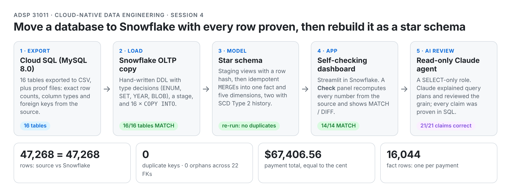
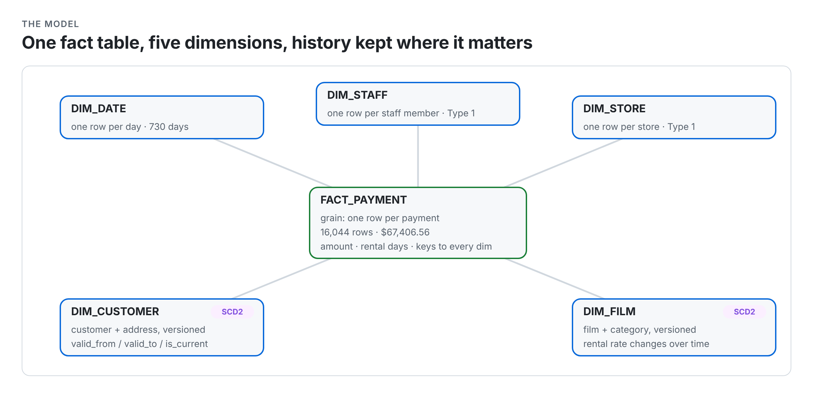
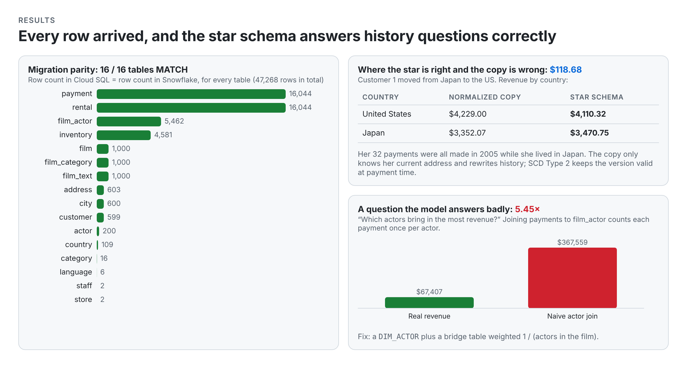

# Sakila: Cloud SQL → Snowflake Star Schema

**Move a 16-table OLTP database from Google Cloud SQL into Snowflake with every row proven, rebuild it as a star schema with SCD Type 2 history, put a self-checking Streamlit app on top, and let a read-only Claude agent explain it, with every explanation proved by a query.**

The rule of the whole project: *the code is cheap; numbers that reconcile are what count.* Every step ends in a number that matches the source to the cent.

## The idea in one picture

<picture>
  <source media="(prefers-color-scheme: dark)" srcset="assets/migration-dark.png">
  
</picture>

<picture>
  <source media="(prefers-color-scheme: dark)" srcset="assets/star-schema-dark.png">
  
</picture>

## What's in here

| Part | Files | What it does |
|---|---|---|
| 1 · Migrate | `part1/01_export_cloudsql.sh` → `02_create_oltp.sql` → `03_stage.sql` → `04_copy.sql` → `05_parity.sql` | Export 16 tables plus proof files (exact row counts, column types, FKs) from Cloud SQL; hand-written Snowflake DDL with the type decisions in its header; file format + stage; 16 × `COPY INTO`; parity checks |
| 2 · Star | `part2/01_dw_ddl.sql` → `02_load_dims.sql` → `03_load_fact.sql` → `04_dw_checks.sql` | DW + staging DDL with the grain in `COMMENT`s; Type 1 and SCD Type 2 dimension `MERGE`s; fact `MERGE` with point-in-time dimension lookups; star-vs-OLTP reconciliation |
| 3 · Prove the model | `part3/01_scd2_history.sql`, `02_where_they_disagree.sql`, `03_answers_badly.sql` | Move a customer and watch SCD2 keep history; find a question where the star and the normalized copy disagree, and say which is right; find a question the model answers badly |
| 4 · App | `part4/streamlit_app.py` | Streamlit in Snowflake on `CLASS_WH` (X-Small, `AUTO_SUSPEND = 60`): one date filter drives every number; a **Check** expander recomputes each number from OLTP and shows MATCH/DIFF with the SQL |
| 5 · Claude | `part5_claude/` | `CLAUDE.md` (facts the agent must not guess), `sql/03_claude_agent.sql` (agent user + read-only role on SAKILA), `docs/dictionary.md` (DW data dictionary Claude wrote headless, every fact tagged with the query that produced it), session prompt log |
| AI disclosure | `prompts.md` | 30-row prompt log for the whole assignment: what I asked, what came back, how I checked it, where Claude was wrong |

## Results

<picture>
  <source media="(prefers-color-scheme: dark)" srcset="assets/results-dark.png">
  
</picture>

**Migration parity:** 16/16 tables MATCH, 47,268 = 47,268 rows; 0 duplicate primary keys in 16 tables; 0 orphans across 22 foreign keys; 13/13 value checks equal (payment total $67,406.56, 183 open rentals, staff photo 36,365 bytes and still a valid PNG). Then the Cloud SQL instance and bucket were deleted (`Listed 0 items`).

**Type decisions** (Snowflake has no ENUM, SET, YEAR or unsigned ints, and doesn't enforce PK/FK):

| MySQL | Snowflake | Why |
|---|---|---|
| `DATETIME` / `TIMESTAMP` | `TIMESTAMP_NTZ` | exported values carry no time zone; `NTZ` keeps the wall-clock value |
| `TINYINT(1)` | `BOOLEAN` | it's a yes/no flag (`customer.active`, `staff.active`) |
| `ENUM` (`film.rating`) | `VARCHAR(5)` + a check query | no ENUM/CHECK in Snowflake: 0 ratings outside the five |
| `SET` (`special_features`) | comma `VARCHAR` in OLTP, `ARRAY` in DW | faithful copy first; `ARRAY_CONTAINS` instead of `LIKE` in the star |
| `YEAR` | `NUMBER(4,0)` | a number, not a date |
| `BLOB` (`staff.picture`) | `BINARY` (exported as hex) | raw bytes would corrupt a CSV |

**Star:** `FACT_PAYMENT` = one row per payment, 16,044 rows, $67,406.56 (= OLTP). Revenue by month, category and store: every row MATCH. `MERGE`s re-run with no duplicates. `DIM_CUSTOMER` and `DIM_FILM` are SCD Type 2 (address/home store; rental rate drops as films age).

**Where the star and the normalized copy disagree (and the star is right):** after moving customer 1 from Sasebo, Japan to Joliet, USA, revenue by country differs by **$118.68**: her 32 payments, all made in 2005 while she lived in Japan. OLTP only knows her current address and rewrites history; the star keeps the version valid at payment time.

**What the model answers badly:** "Which actors bring in the most revenue?" Joining payments to `film_actor` counts each payment once per actor: **$367,559.07 instead of $67,406.56 (5.45×)**. Fix: `DIM_ACTOR` plus a bridge table weighted 1 / (actors in the film).

**App check:** June 2005 filter → 14 of 14 numbers MATCH between DW and OLTP.

**Query tuning (Part 5.1):** filtering on the fact's own `payment_date_key` instead of joining `DIM_DATE` removed a scan, a filter and a join (9 → 6 operators, identical results). At Sakila's size the speed-up is noise (cold 2,262 ms vs warm 281 ms dominates); it matters when the fact spans many micro-partitions.

## Checking Claude: scorecard

| Task | Claims | Correct |
|---|---|---|
| Explain the slowest app query's plan | 5 | 5 |
| Explain the country disagreement | 5 | 5 |
| Grain review by a subagent, then reconciliation queries | 8 | 8 |
| Data dictionary written headless (3 claims spot-checked) | 3 | 3 |

Where Claude was wrong, and how it was caught: it assumed the Week 2 instance name (`gcloud sql instances list` showed the real one); assumed a `COMPUTE_WH` warehouse exists (Snowsight error on line 1); claimed a duplicate source row would stop the `MERGE` (the grain-reviewer subagent showed it would silently double payments, so I fixed the staging view); predicted surrogate key 600 for the new SCD2 version (Snowflake gave 1948: `IDENTITY` is unique, not consecutive); queried a column that only exists in `ACCOUNT_USAGE`; used `Write(...)` in `--allowedTools` where Claude Code needs `Edit(...)`.

## Things I hit that tutorials don't mention

- **`COPY INTO` an empty stage succeeds and loads 0 rows.** Always check `LIST @stage` and the row counts.
- **Snowflake declares PK/FK but never enforces them.** Uniqueness and orphans have to be proven by queries after every load.
- **`CREATE OR REPLACE VIEW` drops its grants.** The agent lost `SELECT` on a staging view once; use `COPY GRANTS`.
- **A `MERGE` only errors when several source rows *update* one target row.** Duplicates on first insert go in silently.
- **`HASH(NULL)` is not NULL**, so it is safe in a row hash for change detection (verified: 3 distinct non-NULL values).
- **Empty string ≠ NULL:** `EMPTY_FIELD_AS_NULL = FALSE` kept 599 empty `address2` values apart from 4 NULLs.

## What would break first at scale

The manual CSV download/upload (the payment file alone would be ~700 MB) and full-table `MERGE`s. Next step: an external stage on the GCS bucket with Snowpipe, and incremental `MERGE`s that read only rows changed since the last load.

## Run order

Part 1: `01_export_cloudsql.sh` in Cloud Shell (needs `env.sh` with PROJECT / INSTANCE / BUCKET), download the CSVs, then `02`–`05` in a Snowsight worksheet as SYSADMIN. Part 2: `01`–`04` in order (safe to re-run). Part 4: paste `streamlit_app.py` into a Streamlit-in-Snowflake app on `CLASS_WH`. Part 5: `sql/03_claude_agent.sql`, then Claude Code with the Snowflake CLI connection `claude` (key-pair auth; `env.example.sh` → `env.sh`, git-ignored).

The Week 4 class kit used in Part 5 (setup script, Claude Code settings/hooks, the grain-reviewer subagent and the dw-reconcile skill) is the instructor's and is not included.

## Context

Built for **ADSP 31011 Cloud-Native Data Engineering** (UChicago MS in Applied Data Science, Autumn 2026). Claude Code was my pair programmer; every prompt, mistake and fix is in `prompts.md`. Published with the instructor's permission to showcase the work. Continues [cloud-sql-sakila-deploy](https://github.com/haokang-uchicago/cloud-sql-sakila-deploy) and [sakila-sql-modeling-and-query-plans](https://github.com/haokang-uchicago/sakila-sql-modeling-and-query-plans); followed by [sakila-mcp-server-streamlit](https://github.com/haokang-uchicago/sakila-mcp-server-streamlit).

**Hao Kang** · [LinkedIn](https://www.linkedin.com/in/hao-kang-6654b5331/) · [GitHub](https://github.com/haokang-uchicago)
